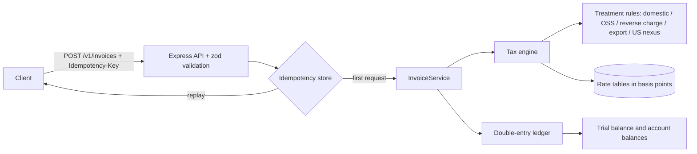

# vat-tax-ledger-engine

A TypeScript demo of an EU VAT (including Ireland) and US sales tax rules engine that posts every invoice into a double-entry ledger, exposed through a small REST API with idempotency keys. Correctness is checked with example tests plus property-based tests (fast-check).

> Portfolio demo. Rates are an illustrative snapshot, VAT IDs are only format checked (no VIES call) and storage is in memory. Not tax advice and not used in production.

## Problem

Billing systems have to answer three questions on every invoice, and get them right every time:

1. **Which tax treatment applies?** Domestic sale, EU cross border B2C (OSS, taxed where the customer is), intra-EU B2B (reverse charge), export (zero rated) or US sales tax where the seller has nexus.
2. **How much, to the cent?** Money must never pass through floating point, and rounding must be deterministic.
3. **Is it booked exactly once?** A client retrying a timed out request must not create a second invoice or a second ledger entry.

## Architecture



Each invoice becomes one balanced journal entry:

| Account | Debit | Credit |
|---|---|---|
| 1100 Accounts receivable | gross | |
| 4000 Sales revenue | | net |
| 2200 VAT payable (or 2210 US sales tax) | | tax |

## Run it

```bash
npm ci
npm run dev            # http://localhost:3000
# or
docker compose up --build
```

Example: an Irish seller selling a digital service to a consumer in Germany (taxed at the German rate under OSS):

```bash
curl -s localhost:3000/v1/tax/quote -H 'content-type: application/json' -d '{
  "seller": {"country": "IE"},
  "customer": {"country": "DE"},
  "supplyType": "digital_services",
  "lines": [{"sku": "PLAN-PRO", "quantity": 1, "unitPrice": 5000}]
}'
# treatment: oss_destination, tax: 950, gross: 5950
```

Issue an invoice safely (retrying with the same key replays the first response):

```bash
curl -s localhost:3000/v1/invoices -H 'content-type: application/json' -H 'Idempotency-Key: order-42' -d '{
  "currency": "EUR",
  "seller": {"country": "IE"},
  "customer": {"country": "IE"},
  "supplyType": "goods",
  "lines": [{"sku": "LAMP", "quantity": 1, "unitPrice": 4500}]
}'
curl -s localhost:3000/v1/ledger/trial-balance
```

### Endpoints

| Method | Path | Purpose |
|---|---|---|
| POST | `/v1/tax/quote` | Calculate treatment and tax without booking anything |
| POST | `/v1/invoices` | Issue an invoice and post it to the ledger (needs `Idempotency-Key`) |
| GET | `/v1/invoices/:id` | Fetch an invoice |
| GET | `/v1/ledger/entries` | Journal entries |
| GET | `/v1/ledger/trial-balance` | Trial balance (debits always equal credits) |
| GET | `/v1/accounts/:code/balance` | Balance of one account |

## Tests

```bash
npm test
```

- **Example tests:** Irish 23% / 13.5% / 9% rates, OSS, reverse charge, export, US nexus, rounding edge cases, validation.
- **Property-based tests (fast-check):**
  - invoice totals always equal the sum of lines, and gross always equals net + tax
  - line order never changes totals
  - rounding error is at most half a cent per line
  - after any random sequence of invoices and reversals, the trial balance balances and receivables equal revenue + tax liabilities
  - concurrent retries with one idempotency key run the handler exactly once
- **API tests (supertest):** idempotent replay, key reuse with a different body (422), trial balance.

CI runs typecheck, tests, build and a Docker smoke test on every push.

## Design decisions

- **Integer cents and basis points.** Amounts are safe integers, rates are basis points (13.5% = 1350), so the only rounding step is one explicit integer division.
- **Per line rounding, half up.** A common invoice convention. Rounding per invoice total is an alternative some jurisdictions allow; switching would be a change in `quote()` only.
- **Treatment first, rate second.** Deciding *where* a supply is taxed is separated from *how much*, which keeps each rule small and testable.
- **Append only ledger.** Entries are frozen once posted; corrections are reversing entries, which preserves the audit trail.
- **Idempotency by key plus request fingerprint.** The body is hashed with a key order independent serialiser, so a retry replays the stored response, a concurrent duplicate waits for the first request, and reusing a key for a different request is rejected.

## Limitations

- Rate tables are a hand maintained snapshot of a subset of countries, with no effective dates.
- No VIES validation, no OSS registration thresholds, no place of supply rules for land, events or transport.
- US support is state level only (no county or city rates, no product taxability).
- In memory storage: a restart loses data. A real build would use Postgres with a unique index on the idempotency key and serializable transactions around posting.

## License

MIT
